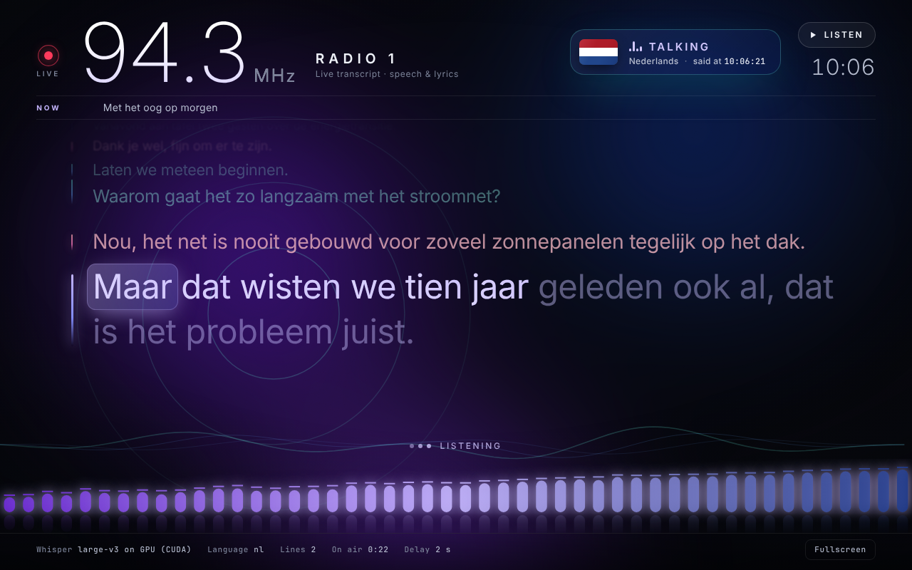
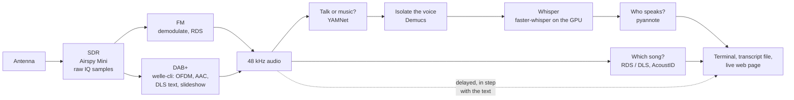
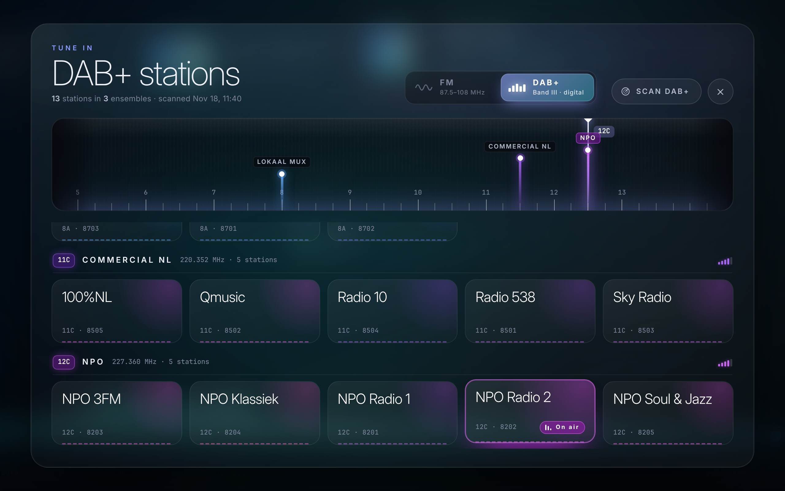

# Visual Radio

**See what the radio says.** Visual Radio receives FM and DAB+ radio with a
software defined radio, works out what is talk and what is music, takes the
music out from under the voice, and writes out every word with Whisper. Live,
on your own PC, without any cloud service. A web page shows the words lighting
up as they are spoken, in a colour per voice, with the song that is playing and
its cover. Phones and tablets in your network can open it too.



| Platform | Status | Folder |
|---|---|---|
| Windows 10/11 + NVIDIA GPU | works | [`windows/`](windows/) · [install](windows/INSTALL.md) · [use](windows/README.md) |
| macOS (Apple Silicon) | planned | [`mac/`](mac/) |

## The model

From antenna to text, every step runs on the PC:



**1. SDR: from radio waves to numbers.** An
[Airspy Mini](https://airspy.com/airspy-mini/) samples a slice of the radio
spectrum 6 million times a second (*IQ samples*). Everything after this point
is software. The Airspy is read through SoapySDR.

**2a. FM.** The program picks one station out of that slice, demodulates it
into mono audio at 48 kHz with the 50 µs European de-emphasis, and decodes RDS
alongside: the station name and the radio text, which often says
"Artist - Title". At the first start it sweeps the whole band, 87.5-108 MHz,
and lists the stations it finds.

**2b. DAB+.** For digital radio the Airspy is handed to
[welle-cli](https://www.welle.io) (welle.io's receiver, included). It locks onto
a multiplex (an *ensemble* of stations on one channel), decodes the AAC audio,
the DLS text (the digital radio text) and the slideshow pictures, and passes
the audio on as plain PCM. Switching between FM and DAB+ is one click on the
page.

**3. Talk or music?** Every piece of about 15 seconds, cut at a quiet moment so
no word is split, goes through
[YAMNet](https://github.com/tensorflow/models/tree/master/research/audioset/yamnet),
Google's sound classifier, in plain NumPy. Talk is written out as sentences;
song lyrics get their own style. When RDS or DLS names a song, that can decide
instead.

**4. Isolate the sound.** Presenters talk over music beds and jingles, and
singers sing over a band, which is hard for Whisper.
[Demucs](https://github.com/facebookresearch/demucs) (Meta's music source
separation) splits each piece into voice and instruments, and Whisper hears only
the voice. The same split also lets you *listen* to only the voice or only the
music in the browser.

**5. Whisper.** [faster-whisper](https://github.com/SYSTRAN/faster-whisper)
runs OpenAI's Whisper `large-v3` on the NVIDIA GPU and returns the text with a
timestamp per word. It detects the language per piece, and switches to the
song's own language for lyrics once the song is known.

**6. Around it.** [pyannote](https://github.com/pyannote/pyannote-audio) hears
when another voice takes over and gives each voice its own colour. Songs are
recognised from RDS / DLS or from their sound
([AcoustID](https://acoustid.org)), with the cover from MusicBrainz.

**7. Out.** Text goes to the terminal, a transcript file and the live web page.
Whisper needs a whole piece before it can write it, so the sound can be played
with a delay (`--delay 30`): then you hear each word at the moment it lights
up, on the PC speakers or in any browser.



## What you need

- An **Airspy Mini** (or R2) and an antenna; for DAB+ one that works around
  200 MHz.
- **Windows** with an **NVIDIA GPU** (8 GB or more is comfortable). It also runs
  on the CPU, but slowly.
- Everything else is free software, installed with conda and pip:
  [windows/INSTALL.md](windows/INSTALL.md).

Quick try without an Airspy:

```
cd windows
conda env create -f environment.yml
conda activate visualradio
python visual_radio.py --simulate --web
```

and open http://localhost:8080.

## In this repository

```
README.md            this page: what Visual Radio is and how it works
docs/images/         screenshots
windows/             the Windows version: program, install guide, tools, tests
  INSTALL.md         step by step, from an empty PC
  README.md          every feature and option
mac/                 the macOS version (planned)
LICENSE              MIT
```

## Credits and licences

Visual Radio's own code is under the [MIT licence](LICENSE). The bundled tools
keep their own licences. Visual Radio stands on these projects: SoapySDR and the Airspy driver,
welle.io (GPL-2.0, `windows/tools/welle-cli.exe`, with the change made for it
in `welle-cli-pcm.diff`), Chromaprint `fpcalc` (LGPL-2.1, for AcoustID),
faster-whisper / CTranslate2 and OpenAI Whisper (MIT), Demucs (MIT), pyannote
(MIT), YAMNet (Apache 2.0), MusicBrainz, the Cover Art Archive and AcoustID.
